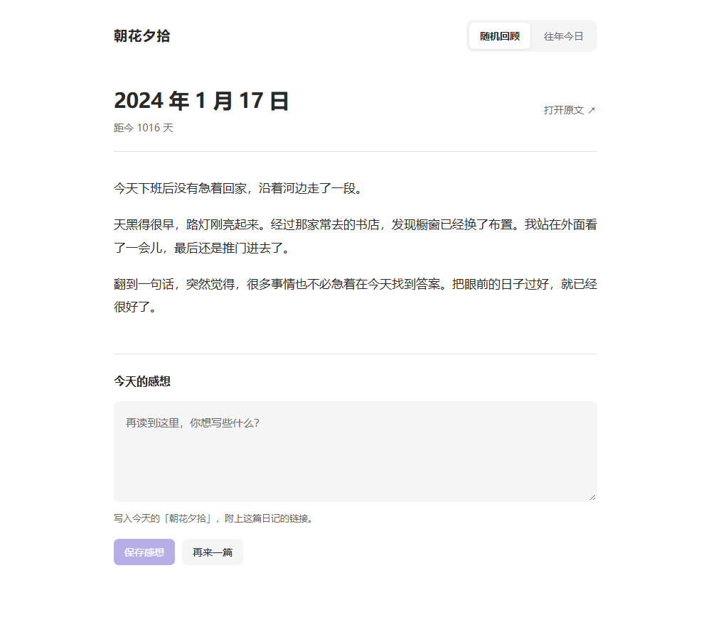

# 朝花夕拾

日记写了很多，却很少回看？

朝花夕拾是一个 Obsidian 日记回顾插件：随机翻开过去的某一天，看看往年的今天，把新的感想保存到今天的日记。

作者：**Tangerine.Cat** · 源码公开 · 禁止售卖及付费集成 · 最低 Obsidian 版本：1.7.2

## 功能

- **随机回顾**：指定日记文件夹，支持年份子目录和 Moment 日期格式；优先未回顾日记，其余按距上次回顾的时长加权。
- **避免重复**：冷却期可配置，默认 7 天；候选耗尽时可手动忽略一次冷却。
- **往年今日**：严格匹配同月同日，通过“下一年”切换年份；2 月 29 日不映射到其他日期。
- **上一篇**：返回刚看过的日记，保存最近 100 条浏览记录，重新打开或重载插件后恢复。
- **阅读正文与图片**：使用 Obsidian 原生 Markdown 渲染，可打开原文，适配主题及窄屏。
- **今天的感想**：自动保存草稿，切换日记后可继续；保存时追加到今天日记的“朝花夕拾”小节，并链接原文。
- **日记模板**：默认沿用“日记”核心插件的目录、日期格式和模板，也可单独指定。
- **本地使用**：不需要 AI 模型、没有遥测或插件主动网络请求。

## 下载与安装

当前提供 **0.1.1 预发布版**，尚未上架 Obsidian 官方第三方插件市场。

1. 打开 [0.1.1 下载页](https://github.com/Tangerine-Cat888/zhaohua-xishi/releases/tag/0.1.1)。
2. 下载 Assets 中的 main.js、manifest.json、styles.css 和 LICENSE。
3. 在你的库中创建 `.obsidian/plugins/zhaohua-xishi/`，将这四个文件放入其中。若修改过库配置目录，请使用自己的配置目录。
4. 重新加载 Obsidian，在“设置 → 第三方插件”中启用“朝花夕拾”。
5. 在插件设置中指定要回顾的日记文件夹及日期格式。

升级时替换以上四个文件，保留自己的 data.json。请不要将个人 data.json 上传到本仓库。

## 使用与设置

点击侧栏翻书图标，或运行“朝花夕拾：随机回顾／往年今日”命令。仅回顾早于今天、日期有效的日记。

例如日记位于 `Diary/2024/2024-01-17.md`，可以设置：

| 设置 | 示例 |
| --- | --- |
| 日记文件夹 | Diary |
| 包含子文件夹 | 开启 |
| 日记日期格式 | YYYY-MM-DD |
| 冷却期 | 7 天 |
| 感想小节名称 | 朝花夕拾 |

日期格式包含斜杠时按日记目录下的相对路径匹配，否则按文件名匹配。使用 Moment 格式，文字常量使用方括号，例如 `YYYY-MM-DD[日记]`。

### 感想与链接

保存后追加以下内容，不修改原日记：

```markdown
## 朝花夕拾

回顾 [[2024-01-17]]

今天的感想。
```

“回顾”是普通正文，不是标题。链接遵循库的 Wiki/Markdown 链接设置，并处理重名路径；在原日记的反向链接中可找到今天的记录。

### 日记模板

默认在保存时读取 Obsidian“日记”核心插件的目录、日期格式及模板。若核心插件尚无配置，采用默认值：库根目录、YYYY-MM-DD、无模板。

在“设置 → 朝花夕拾 → 日记模板”中切换为“单独指定”，可设置独立目录、日期格式及模板文件。自定义模板留空即不使用模板；日期格式不含 .md，可包含年份子目录。

仅在今日日记不存在时应用模板，已有日记只追加感想。支持核心模板的 {{title}}、{{date}}、{{time}} 及自定义日期时间格式。模板不存在或读取失败会提示并保留草稿。

暂不执行 Templater 动态脚本。使用此类模板时，请先通过 Templater 创建今日日记，再保存感想。

## 隐私

日记和感想不发送给服务器。设置、草稿和浏览历史保存在本库的插件 data.json 中，备份和同步时请同样保护它。

日记中原有的远程图片或嵌入内容仍遵循 Obsidian 的渲染行为。详见 [隐私说明](PRIVACY.md)。

## 界面预览

以下为使用虚构日记制作的早期界面示意，部分细节可能与当前版本不同，不是个人日记截图。



## 开发与验证

使用 Node.js 22 或更高版本：

```sh
npm ci
npm run release:check
```

检查包括 ESLint、20 项自动测试、TypeScript、构建及发布文件白名单校验。构建产物位于 dist/zhaohua-xishi，仅含 main.js、manifest.json、styles.css 和 LICENSE，不包含用户设置或日记。

部分功能已在 Obsidian 1.14.5 桌面和移动模拟环境中验收；模板支持已通过自动测试。手机真机、最低版本 1.7.2 和完整进程冷启动尚未实测。

GitHub Actions 在 main 分支推送、PR 或手动触发时运行检查。

## 反馈

请通过 [Issues](https://github.com/Tangerine-Cat888/zhaohua-xishi/issues) 反馈问题，说明 Obsidian 和插件版本、复现步骤。示例请使用虚构日记，截图请先隐藏私人内容。

## 使用许可

从 0.1.1 起采用自定义的[朝花夕拾源码使用许可](LICENSE)，不再标注为 MIT 或标准开源软件。

- 允许个人使用、工作中自用、企业内部使用、修改及免费分享。
- 禁止售卖插件、付费打包，以及集成到对外收费的产品或服务中获利；另行取得作者书面授权的除外。
- 分享或修改时须保留许可和版权声明。

具体范围以 LICENSE 全文为准。
