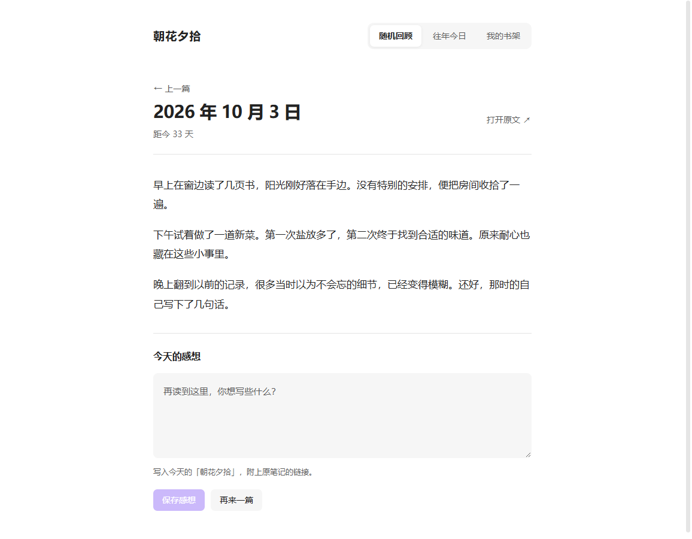
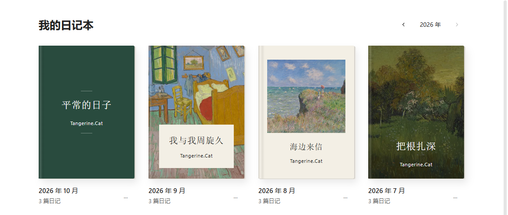
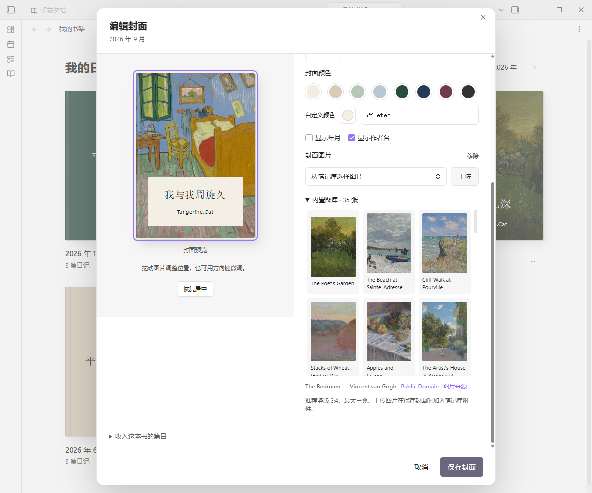
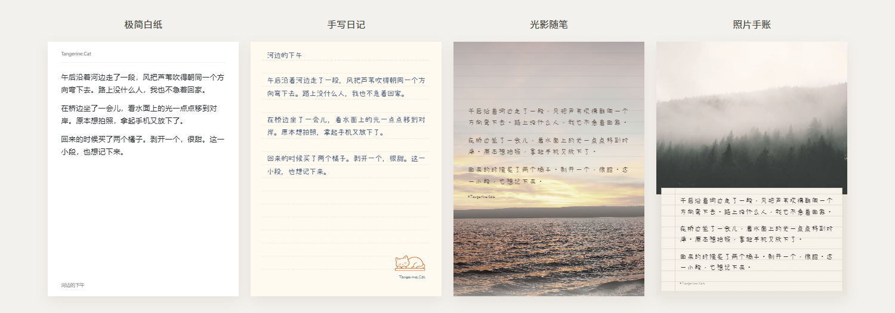
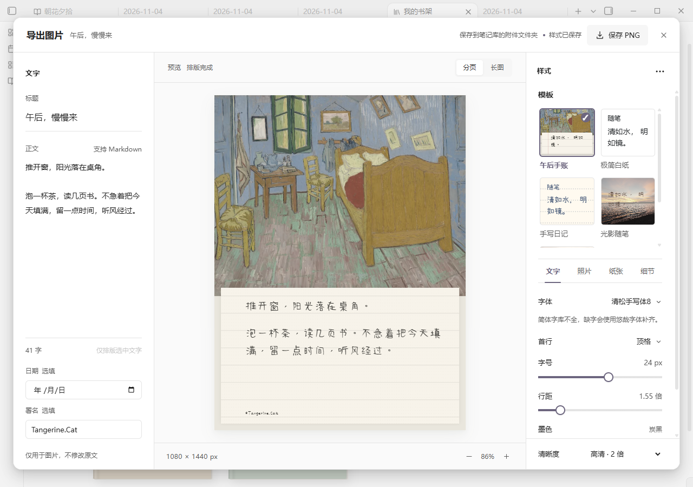
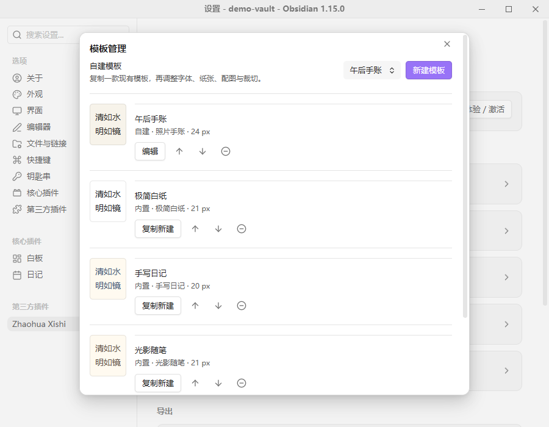
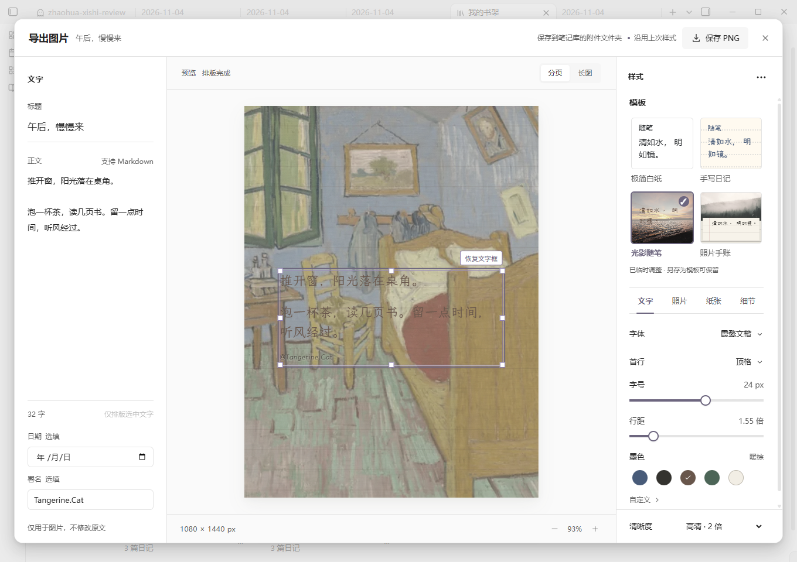

# 朝花夕拾 · Zhaohua Xishi

随机翻看旧日记，重读往年今日，把现在的感想写进今天。也可以把笔记放上书架，或排成图片保存下来。

**0.5.0：在预览里拖动图片、调整文字框，双击文字直接编辑。**

0.5.1 修复预览编辑的兼容性与审核规范问题，功能和会员权益不变。

[English](#english) · [插件主页](https://community.obsidian.md/plugins/zhaohua-xishi) · [问题反馈](https://github.com/Tangerine-Cat888/zhaohua-xishi/issues)

## 回顾日记和笔记

- **随机回顾**：从选定的文件夹中随机打开一篇旧日记或笔记，可以阅读正文、查看图片，也可以打开原文。
- **往年今日**：查看过去几年同一天写下的内容。
- **保存感想**：边看边写下现在的想法，保存到今天的日记，并附上原文链接。
- **回顾记录**：返回刚刚读过的内容，接着看。

这些功能永久免费。

除了日记，也可以在设置的“管理回顾集”中添加读书笔记、工作日志等文件夹，切换要回顾的内容。没有日期的笔记也能随机回顾；往年今日需要能识别日期的笔记。所有感想统一保存到今天的日记。

## 把笔记放上书架

“我的书架”是可选的付费功能，可以把日记按月份分成一本本日记本，也可以把不同子文件夹里的笔记分别作为一本书阅读。

从左到右是经典文字、摄影题签、留白画册、满版影像。同一张书架上可以使用不同的封面样式。

- 从目录选择篇目，调整阅读字号。
- 设置书名，以及目录中显示的笔记标题。
- 从内置的 35 张图片中选择封面，或使用自己的图片。
- 直接拖动封面图片，调整显示位置。

展开“内置图库”，点击图片就能预览封面效果。以上截图使用示例日记。

## 把喜欢的文字排成图片

读到想留下的一段日记，或想分享一篇笔记，可以直接排版成图。不必复制到其他软件，也可以只选中其中几句话。

图片导出包含在永久会员中，也可主动开启完整体验：早鸟期间新开通 72 小时，之后新开通 24 小时。四款模板均可使用，无水印、不限导出次数。

同一段示例文字，四种排法。上图将插件实际预览并排展示，照片和字体均来自内置资源。

四款模板各有不同的排法：

| 模板 | 样式 |
| --- | --- |
| 极简白纸 | 简洁的纸面，以文字为主 |
| 手写日记 | 手写字体，搭配横线、方格或点阵纸 |
| 光影随笔 | 照片铺满画面，文字叠在照片上 |
| 照片手账 | 照片搭配手写便笺 |

- 调整字体、字号、行距、纸色和文字颜色，选择是否显示标题、日期和署名。
- 使用内置图片或添加自己的照片，拖动、缩放调整照片位置。
- 选择 3:4、1:1、9:16 画幅，导出分页图片或连续长图；保存当前页 PNG，或将全部页面打包成 ZIP。
- 调好以后，点击样式栏右上角的三点菜单，选择 **另存为模板**。下次在模板列表里选中它，就能用回同一套字体、纸色、配图和裁切；正文仍来自当前笔记。
- 在设置的 **模板管理** 中复制新建、编辑、排序、移除和恢复模板。旧“我的样式”会保留并加入列表；重新打开导出窗口时，沿用上次的排版和临时调整。
- 常用字体和配色也能自己整理；支持从文件添加字体，在支持的桌面环境中选择电脑已安装的字体。

在回顾页或书架阅读页点击 **导出图片**；也可以在编辑器中选中文字后右键导出，或运行 **导出当前笔记为图片** 命令。导出窗口里改动的文字不会写回原笔记。

左侧改文字，中间看效果，右侧调整模板和样式。排好后，点击右上角保存图片。截图使用演示文字。

移除的模板可以恢复；“彻底删除”需要再次确认，操作后不能从列表恢复。导入的照片和字体会保留。

首次导出需主动下载字体和图库，之后无需联网。图片默认保存在当前笔记的附件文件夹，也可以指定库内目录和命名方式。同名文件会自动编号，保留已有图片。排版与图片生成都在本机完成。

支持常见 Markdown 内容、双链文字和库内图片。暂不支持公式、Dataview、整篇笔记嵌入及其他插件动态内容；缺失图片或外链图片会提示，不能直接按原样导出。

### 直接在预览里调整

光影随笔中，可以拖动文字框、调整宽度，双击文字修改这一张图的内容。正文图片可以移动、等比缩放、对齐或复位；其他模板中的正文图片也可以调整大小和排列位置。拖动时暂停导出，完成调整后再保存。

截图使用演示内容。

纸感强度可以单独调整，照片上的署名会根据背景明暗选择更清楚的颜色。文字框可以随模板保存；正文图片的临时位置用于当前排版，不写回原笔记。

## 按自己的习惯阅读

回顾页和书架可以统一设置字体、字号、行距和正文宽度。

不想回顾草稿，或想让刚写完的内容先放一放，可以按文件夹、标签排除笔记，也可以跳过最近几天的内容。筛选同时用于随机回顾和往年今日，不影响书架里的篇目。

## 开始使用

### 设置回顾来源

1. 在 Obsidian 的 **设置 → 第三方插件 → 浏览** 中搜索 **Zhaohua Xishi**，安装并启用。
2. 打开插件设置，指定日记文件夹和文件名的日期格式。也可以沿用 Obsidian 核心日记插件的目录、日期格式和模板。
3. 点击侧栏中的插件入口，选择“随机回顾”或“往年今日”。

例如，日记路径是 `Diary/2024/2024-01-17.md`，将文件夹设为 `Diary`、日期格式设为 `YYYY-MM-DD`，并开启包含子文件夹。

要回顾其他文件夹，在“管理回顾集”中添加即可。日期识别、标题来源和成书方式的详细设置见 [回顾集说明](docs/REVIEW-SETS.md)。

## 价格与激活

随机回顾、往年今日、回顾记录、保存感想和回顾集管理永久免费。新版中的回顾筛选也免费。

**永久会员：正式发布起 14 天早鸟价 ¥19.9，之后 ¥39.9。** 早鸟时间：北京时间 **2026/11/7 19:33:19 至 2026/11/21 19:33:19**，截止时起恢复原价。包含书架阅读、四款模板完整图片导出、字体与颜色定制、自定义样式、后续本地功能更新及售后支持。已有永久会员直接享有全部权益，无须补差价或重新激活。

未购买用户可在授权页主动开启 **完整会员体验：早鸟期间新开通 72 小时，早鸟结束后新开通 24 小时**，不限导出次数、无水印，不自动扣费。到期恢复免费版，笔记、已导出图片、照片与已保存样式均保留，购买后继续使用。已开始的试用保留原到期时间，不因升级或早鸟结束而缩短。价格以购买时为准。

试用记录保存在本机 Obsidian 的应用存储中，不随笔记库同步；正常重启不会重置。离线试用不保证跨设备、清空应用数据或修改系统时间后的严格防重复。

购买方式：在插件设置中找到“授权与支持”，添加作者微信 **qian_yu_sui**，发送本机申请码。收到授权码后，回到同一页面粘贴激活。

授权保存在本机，不随笔记库同步。换机、清空应用数据或部分重装操作后，可能需要联系作者重新签发。

## 常见问题

### 日记会上传吗？

插件在本地读取笔记，不上传日记，不调用 AI，也不收集使用数据。笔记中已有的远程图片或嵌入内容，仍可能由 Obsidian 联网加载。详见 [隐私说明](PRIVACY.md)。

### 支持哪些设备？

目前已在 Windows 桌面端测试。手机端和声明的最低 Obsidian 1.7.2 版本尚未完成实测。

### 如何手动安装或升级？

从 [最新发布页](https://github.com/Tangerine-Cat888/zhaohua-xishi/releases/latest) 下载 `main.js`、`manifest.json` 和 `styles.css`，放入笔记库的 `.obsidian/plugins/zhaohua-xishi/` 文件夹，再重新加载插件。升级时保留已有的 `data.json`。

首次导出时，点击下载约 53 MB 的字体和图库，完成后可离线使用。程序随插件安装，不会从网络下载执行代码。也可下载发布页中的完整 ZIP，将其中 `zhaohua-xishi` 文件夹合并到插件目录。升级时保留 `data.json`、`export-photos/` 和 `export-fonts/`。

### 遇到问题在哪里反馈？

可以在 GitHub [提交问题](https://github.com/Tangerine-Cat888/zhaohua-xishi/issues)，附上 Obsidian 版本、插件版本和复现步骤。截图请遮住私人日记内容，不要附上授权码。

## 授权与离线使用

新版加强了授权状态和试用记录的防篡改检查，保存图片前也会再次确认权益。已有永久授权继续离线使用，旧试用保留原到期时间，无须重新发码。异常记录会提示处理方式，免费回顾与已有内容保留。这是本地防护加固，不承诺无法破解。

## 作者与许可

作者：Tangerine.Cat。

公开仓库提供安装包与使用说明；当前版本源码在私有仓库维护，并提供给 Obsidian 审核。公开仓库保留的旧版源码不代表当前版本的实现。

使用与分享请遵循 [LICENSE](LICENSE)，未经作者授权不得转售或付费打包；既有版本已授予的权利不受后续许可变更的追溯影响。封面图片的来源与许可见 [图库说明](assets/covers/README.md)。

源码修改许可不自动授予付费权益。许可保留正常维护、合法修改及善意安全研究的空间，同时限制以获取未经授权付费权益为目的的绕过与解锁版本分发。激活失败、换机恢复及研究报告方式见 [授权边界与故障处理](docs/LICENSE-SUPPORT.md)。

---

## English

Rediscover old journal entries, revisit this day in past years, and save reflections to today's note. Read notes on a bookshelf or turn them into images.

**Version 0.5.0 adds image positioning, resizable text frames, and direct text editing in the preview.**

### Review your notes

- **Random review**: Open a random past entry or note from a selected folder. Read its text and images, or open the original file.
- **On this day**: Read entries from the same date in previous years.
- **Save comments**: Write a comment while reading and save it to today's daily note, with a link to the original.
- **Review history**: Go back to entries you have just read.

These features are free. You can also add separate review sets for reading notes, work logs, or other folders. Undated notes support random review; on-this-day review requires a valid date. Comments from all sets go to today's daily note.

### Read notes as books

The optional paid bookshelf groups entries into books by month or subfolder. Choose an entry from the table of contents, adjust the font size, and customize book titles and covers. Choose from 35 bundled cover images or use your own, then drag the image to adjust its position.

Books are for reading inside Obsidian. Ebook and PDF export are not supported.

From left to right: text, photo label, framed image, and full image. You can mix layouts on the same shelf.

Choose an image from the built-in gallery, preview it, and drag to adjust its position. Screenshots use sample journal entries.

### Turn notes into images

Export a whole note or a selected passage using four templates: a minimal page, a handwritten diary, text over a full photo, or a photo with a handwritten paper note.

Image export is included in lifetime membership and an optional full trial: 72 hours when started during the early-bird period, or 24 hours afterward. All four templates are available, with no watermark or export limit.

The same sample passage in four layouts, shown side by side using the plugin's actual previews and bundled fonts and photos.

Adjust fonts, spacing, paper and text colors, and title, date, and author visibility. Use bundled images or your own photos, then drag and zoom to frame them. Choose **另存为模板** from the three-dot menu to save the layout, photo, and crop without the note text or author. Select it from the same list as built-in templates next time.

Use **模板管理** in settings to copy, edit, reorder, remove, or restore templates. Existing saved styles are retained. Reopening the export window keeps your last layout and temporary adjustments. Organize favorite fonts and colors, import font files, or select installed computer fonts on supported desktops.

Choose a 3:4, 1:1, or 9:16 format, with separate pages or one long image. Save the current page as PNG or all pages as a ZIP. Open **导出图片** from a review or book reader, use the editor context menu, or run **导出当前笔记为图片**. Text edits in the export window do not change the original note.

Edit text on the left, preview it in the center, and adjust templates and styles on the right. Save the image from the top-right button. This screenshot uses sample text.

Removed templates can be restored. Permanent deletion requires confirmation and cannot be undone from the list; imported photos and fonts are retained.

Images are generated locally and saved to the note's attachment folder by default. You can choose another vault folder and filename format; existing files are preserved. Common Markdown content, wikilink text, and local images are supported. Formulas, Dataview, whole-note embeds, and other dynamic plugin content are not supported. Missing or remote images need to be resolved before export.

### Edit the preview

In the full-photo essay layout, move and resize text frames or double-click to edit text for the image. Move, proportionally resize, align, or reset inline images. Other layouts also support sizing and rearranging inline images. Adjust paper texture strength; signatures adapt to the photo background. Text frames can be saved with a template. Temporary inline-image positions apply to the current composition and do not modify the source note.

### Adjust reading and review filters

Set the reading font, size, line spacing, and text width for reviews and books. Exclude folders, tags, or recent notes from random and on-this-day review. These filters do not change bookshelf contents.

### Get started

1. Search for **Zhaohua Xishi** in Obsidian's community plugins, then install and enable it.
2. Set your journal folder and filename date format. You can reuse the core Daily Notes folder, date format, and template.
3. Open the plugin from the ribbon and choose random review or on-this-day review.

For a file such as `Diary/2024/2024-01-17.md`, set the folder to `Diary`, use `YYYY-MM-DD`, and include subfolders. Add other folders through the review-set manager in settings.

For manual installation, download `main.js`, `manifest.json`, and `styles.css` from the [latest release](https://github.com/Tangerine-Cat888/zhaohua-xishi/releases/latest). Place them in `.obsidian/plugins/zhaohua-xishi/` and reload the plugin. Keep your existing `data.json` when upgrading.

On first export, click to download approximately 53 MB of fonts and images from GitHub. They are then available offline. Executable code ships with the plugin, not the download. Alternatively, merge the complete ZIP package into your plugins folder. Preserve `data.json`, `export-photos/`, and `export-fonts/` when upgrading.

### Pricing

Random review, on-this-day review, review history, comments, and review-set management are permanently free.

Optional lifetime membership costs **CNY 19.9 for 14 days from the public release, then CNY 39.9**. The early-bird window is 2026-11-07T11:33:19.070Z through 2026-11-21T11:33:19.070Z (UTC); the regular price applies at the end instant. Membership includes bookshelf reading, full image export with all four templates, fonts and colors, saved styles, future local feature updates, and support. Existing lifetime members receive all benefits without an upgrade fee or reactivation. Users can explicitly start a **full trial: 72 hours during the early-bird period, or 24 hours afterward**, with no watermark, export limit, or automatic charge. After expiry, free review remains available and notes, exported images, photos, and saved styles are retained. Existing trials retain their original expiry, including legacy 72-hour records. Starting a trial does not reserve the early-bird price. Offline trial records stay in local Obsidian application storage and are not synced with the vault. To purchase, contact the author on WeChat at **qian_yu_sui** and send the device request code shown in plugin settings. Paste the returned license code into the same settings page to activate.

Activation is stored on the device and does not sync with your vault. Changing devices, clearing application data, or some reinstallations may require a replacement license.

### Privacy, compatibility, and support

The plugin reads notes locally. It does not upload journals, use AI, or collect usage data. Obsidian may still load remote images and embeds in your notes. See the [privacy policy](PRIVACY.md).

Tested on Windows desktop. Physical mobile devices and the declared minimum Obsidian version, 1.7.2, have not yet been tested.

[Report an issue](https://github.com/Tangerine-Cat888/zhaohua-xishi/issues) with your Obsidian version, plugin version, and steps to reproduce the problem. Do not include private journal content or license codes.

The public repository provides releases and documentation. Current source is private and available to Obsidian for review; historical public source does not represent the current release. See [LICENSE](LICENSE) for terms and [cover credits](assets/covers/README.md) for image sources and licenses.

Permission to modify the source does not automatically grant paid entitlements. The license preserves legitimate maintenance, modifications, and good-faith security research while restricting bypasses and unlocked distributions intended to provide unauthorized paid access. See [licensing boundaries and support](docs/LICENSE-SUPPORT.md) for activation recovery and reporting guidance.
